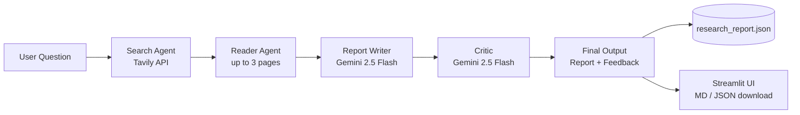

<div align="center">

# 🔬 Multi-Agent Research System

**An autonomous research assistant that searches the web, reads sources, writes an evidence-led report, and has a critic review it.**


</div>

---

## 📑 Table of Contents

- [Overview](#-overview)
- [Features](#-features)
- [Tech Stack](#-tech-stack)
- [Architecture](#-architecture)
- [Requirements](#-requirements)
- [Setup](#-setup)
- [Run the App](#-run-the-app)
- [Run from the Command Line](#-run-from-the-command-line)
- [Project Structure](#-project-structure)
- [Output Format](#-output-format)
- [Troubleshooting](#-troubleshooting)
- [Notes and Limitations](#-notes-and-limitations)
- [Contributing](#-contributing)
- [Author](#-author)

---

## 🧭 Overview

Multi-Agent Research System splits a research task across specialised agents instead of relying on a single prompt. One agent finds recent sources, another reads the most relevant pages, a writer composes a structured report, and a critic reviews it for accuracy, evidence, completeness, and clarity.

You can use it through a **Streamlit web interface** or run the **pipeline directly from the terminal**.

## ✨ Features

- **Web research agent** – finds recent, relevant sources using the Tavily Search API.
- **Webpage reader agent** – extracts text from up to three relevant pages.
- **Report writer** – produces a structured report with findings, limitations, a conclusion, and source URLs.
- **Critic pipeline** – reviews the report for accuracy, evidence, completeness, and clarity.
- **Streamlit interface** – displays the report, supporting evidence, and critic feedback.
- **Downloadable results** – export as Markdown or JSON.
- **Persistent output** – the latest run is saved to `research_report.json`.

## 🛠️ Tech Stack

| Technology | Role in the project |
| --- | --- |
| **Python 3.10+** | Core language for the agents, pipeline, and tools |
| **Streamlit** | Interactive web interface for running research and viewing results |
| **Pipeline** (`pipeline.py`) | Orchestrates search → read → write → critique stages |
| **Tavily API** | Web search and page content retrieval for research |
| **Gemini API** (`gemini-2.5-flash`) | LLM powering the agents, report writer, and critic |
| **LangChain** | Connects Gemini to agents, tools, and chains |
| **GitHub** | Version control and project hosting |

## 🏗️ Architecture



**Pipeline stages**

1. **Search** – the search agent queries Tavily for recent, relevant sources.
2. **Read** – the reader agent extracts text from up to three selected pages.
3. **Write** – the report writer builds a structured, evidence-led report.
4. **Critique** – the critic evaluates accuracy, evidence, completeness, and clarity.
5. **Deliver** – results are shown in the UI and saved as JSON.

## 📋 Requirements

- Python 3.10 or newer
- A [Google AI API key](https://aistudio.google.com/app/apikey)
- A [Tavily API key](https://tavily.com/)

## ⚙️ Setup

**1. Clone the repository**

```bash
git clone https://github.com/Mahesh-011-vk/Multi-Agent-Research-System.git
cd Multi-Agent-Research-System
```

**2. Create and activate a virtual environment**

```bash
python -m venv .venv
```

macOS / Linux:

```bash
source .venv/bin/activate
```

Windows PowerShell:

```powershell
.venv\Scripts\Activate.ps1
```

**3. Install dependencies**

```bash
python -m pip install --upgrade pip
pip install -r requirements.txt
```

**4. Configure environment variables**

Create a `.env` file in the project root. Set your Google key as either `GOOGLE_API_KEY` or `GEMINI_API_KEY`, and your Tavily key as `TAVILY_API_KEY`:

```dotenv
GOOGLE_API_KEY=your_google_ai_api_key
TAVILY_API_KEY=your_tavily_api_key
```

> 🔒 Keep `.env` private. Never commit API keys. Make sure `.env` is listed in your `.gitignore`.

## 🚀 Run the App

Start the Streamlit interface:

```bash
streamlit run app.py
```

Open the local URL printed in the terminal, enter a focused research question, and select **Run research**. Completed reports can be downloaded from the interface, and the latest results are saved to `research_report.json` in the working directory.

## 💻 Run from the Command Line

```bash
python pipeline.py
```

Enter a topic when prompted. The pipeline prints the search results, extracted webpage content, report, and critic feedback, then writes the full results to `research_report.json`.

## 📁 Project Structure

```text
Multi-Agent-Research-System/
├── app.py             # Streamlit research interface
├── pipeline.py        # Coordinates search, reading, writing, and critic stages
├── agent.py           # Gemini-backed agents and report/critic chains
├── tools.py           # Tavily web search and webpage extraction tools
├── requirements.txt   # Python dependencies
└── .env               # API keys (not committed)
```

| File | Purpose |
| --- | --- |
| `app.py` | Streamlit research interface |
| `pipeline.py` | Coordinates the search, reading, writing, and critic stages |
| `agent.py` | Configures the Gemini-backed agents and report/critic chains |
| `tools.py` | Tavily web search and webpage extraction tools |
| `requirements.txt` | Python dependencies |

## 📄 Output Format

Each run produces a report with:

- **Findings** – key points supported by sources
- **Limitations** – gaps or uncertainty in the evidence
- **Conclusion** – a concise summary
- **Sources** – the URLs used
- **Critic feedback** – review of accuracy, evidence, completeness, and clarity

The full run is saved to `research_report.json`.

## 🩺 Troubleshooting

| Problem | Likely cause | Fix |
| --- | --- | --- |
| `API key not found` error | `.env` missing or misnamed | Confirm `.env` is in the project root with `GOOGLE_API_KEY` (or `GEMINI_API_KEY`) and `TAVILY_API_KEY` |
| Quota or rate-limit errors | Provider usage limits reached | Wait and retry, or check your Google AI / Tavily plan |
| Empty or partial page content | Site blocks automated requests | Try a different question or rely on other sources |
| `ModuleNotFoundError` | Dependencies not installed or venv inactive | Activate the venv and rerun `pip install -r requirements.txt` |
| `streamlit` not found | Not installed in the active environment | `pip install streamlit` inside the venv |

## ⚠️ Notes and Limitations

- Research requires network access and valid Google AI and Tavily API keys. Provider quotas and usage limits may apply.
- Search results and extracted page content depend on source availability and may be incomplete. Verify important claims against the linked sources.
- The webpage reader retrieves publicly accessible HTTP/HTTPS pages; some sites may block automated requests.

## 🤝 Contributing

Contributions are welcome.

1. Fork the repository
2. Create a feature branch: `git checkout -b feature/your-feature`
3. Commit your changes: `git commit -m "Add your feature"`
4. Push the branch: `git push origin feature/your-feature`
5. Open a pull request

## 👤 Author

**Mahesh S**

- GitHub: [Mahesh-011-vk](https://github.com/Mahesh-011-vk)
- LinkedIn: [mahesh-s-318367203](https://linkedin.com/in/mahesh-s-318367203)

---

<div align="center">

⭐ If you find this project useful, consider giving it a star on GitHub.

</div>
