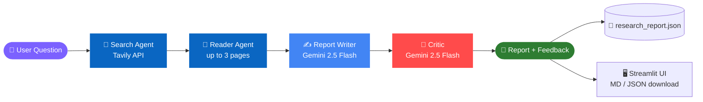

<div align="center">


<a href="https://github.com/Mahesh-011-vk/Multi-Agent-Research-System">
  
</a>

<br/>


<br/>

**[✨ Features](#-features) · [🛠️ Tech Stack](#️-tech-stack) · [🏗️ Architecture](#️-architecture) · [⚡ Quick Start](#-quick-start) · [📁 Structure](#-project-structure) · [🩺 Troubleshooting](#-troubleshooting)**

</div>

---

## 🎯 Overview

> **Ask one question. Get a researched, cited, and peer-reviewed report.**

Instead of relying on a single prompt, this project splits research across **specialised AI agents**. One finds fresh sources, another reads the best pages, a writer drafts a structured report, and a **critic** audits it for accuracy, evidence, completeness, and clarity.

Use it through a clean **Streamlit web app** or straight from the **command line**.

<div align="center">

<!-- 📸 Add a screenshot or GIF of your Streamlit app here:
 -->

</div>

---

## ✨ Features

<table>
<tr>
<td width="50%" valign="top">

### 🔎 Web Research Agent
Finds recent, relevant sources using the **Tavily Search API**.

### 📖 Webpage Reader Agent
Extracts clean text from up to **three** of the most relevant pages.

### ✍️ Report Writer
Builds a structured report with findings, limitations, a conclusion, and source URLs.

</td>
<td width="50%" valign="top">

### 🧐 Critic Pipeline
Reviews the report for **accuracy, evidence, completeness, and clarity**.

### 🖥️ Streamlit Interface
View the report, evidence, and critic feedback in one place.

### 💾 Export Ready
Download as **Markdown** or **JSON**. Latest run is auto-saved to `research_report.json`.

</td>
</tr>
</table>

---

## 🛠️ Tech Stack

<div align="center">


</div>

| Layer | Technology | Purpose |
| :---: | --- | --- |
| 🐍 | **Python 3.10+** | Core language for agents, pipeline, and tools |
| 🎈 | **Streamlit** | Interactive web UI for running research and viewing results |
| 🔗 | **Pipeline** (`pipeline.py`) | Orchestrates search → read → write → critique |
| 🌐 | **Tavily API** | Real-time web search and content retrieval |
| 🤖 | **Gemini API** (`gemini-2.5-flash`) | LLM powering the agents, writer, and critic |
| ⛓️ | **LangChain** | Connects Gemini to agents, tools, and chains |
| 🐙 | **GitHub** | Version control and project hosting |

---

## 🏗️ Architecture



### 🔄 How it works

| Step | Stage | What happens |
| :---: | --- | --- |
| **1** | 🔎 **Search** | The search agent queries Tavily for recent, relevant sources |
| **2** | 📖 **Read** | The reader agent extracts text from up to three selected pages |
| **3** | ✍️ **Write** | The writer composes a structured, evidence-led report |
| **4** | 🧐 **Critique** | The critic scores accuracy, evidence, completeness, and clarity |
| **5** | 📦 **Deliver** | Results appear in the UI and are saved as JSON |

---

## ⚡ Quick Start

### 📋 Prerequisites

- 🐍 Python **3.10** or newer
- 🔑 A [Google AI API key](https://aistudio.google.com/app/apikey)
- 🔑 A [Tavily API key](https://tavily.com/)

### 1️⃣ Clone the repository

```bash
git clone https://github.com/Mahesh-011-vk/Multi-Agent-Research-System.git
cd Multi-Agent-Research-System
```

### 2️⃣ Create a virtual environment

```bash
python -m venv .venv
```

<details>
<summary><b>🍎 macOS / 🐧 Linux</b></summary>

```bash
source .venv/bin/activate
```

</details>

<details>
<summary><b>🪟 Windows PowerShell</b></summary>

```powershell
.venv\Scripts\Activate.ps1
```

</details>

### 3️⃣ Install dependencies

```bash
python -m pip install --upgrade pip
pip install -r requirements.txt
```

### 4️⃣ Add your API keys

Create a `.env` file in the project root. Use either `GOOGLE_API_KEY` or `GEMINI_API_KEY` for Google, plus `TAVILY_API_KEY`:

```dotenv
GOOGLE_API_KEY=your_google_ai_api_key
TAVILY_API_KEY=your_tavily_api_key
```

> [!WARNING]
> Keep `.env` private. Never commit API keys, and make sure `.env` is in your `.gitignore`.

---

## 🚀 Usage

### 🖥️ Option A: Streamlit app

```bash
streamlit run app.py
```

Open the local URL from the terminal, enter a focused research question, and click **Run research**. Download the finished report from the interface. The latest results are also saved to `research_report.json`.

### 💻 Option B: Command line

```bash
python pipeline.py
```

Enter a topic when prompted. The pipeline prints search results, extracted page content, the report, and critic feedback, then writes everything to `research_report.json`.

> [!TIP]
> Focused questions give better results. Try *"What are the latest advances in retrieval-augmented generation?"* instead of *"Tell me about AI"*.

---

## 📁 Project Structure

```text
Multi-Agent-Research-System/
├── 🎈 app.py             # Streamlit research interface
├── 🔗 pipeline.py        # Coordinates search, read, write, and critic stages
├── 🤖 agent.py           # Gemini-backed agents and report/critic chains
├── 🛠️ tools.py           # Tavily search and webpage extraction tools
├── 📦 requirements.txt   # Python dependencies
└── 🔒 .env               # API keys (never committed)
```

| File | Purpose |
| --- | --- |
| `app.py` | Streamlit research interface |
| `pipeline.py` | Coordinates the search, reading, writing, and critic stages |
| `agent.py` | Configures the Gemini-backed agents and report/critic chains |
| `tools.py` | Tavily web search and webpage extraction tools |
| `requirements.txt` | Python dependencies |

---

## 📄 Report Output

Every run produces:

- 📌 **Findings**: key points backed by sources
- ⚖️ **Limitations**: gaps or uncertainty in the evidence
- 🏁 **Conclusion**: a concise summary
- 🔗 **Sources**: the URLs used
- 🧐 **Critic feedback**: review of accuracy, evidence, completeness, and clarity

---

## 🩺 Troubleshooting

<details>
<summary><b>🔑 API key not found</b></summary>

Confirm `.env` is in the project root and contains `GOOGLE_API_KEY` (or `GEMINI_API_KEY`) and `TAVILY_API_KEY`.

</details>

<details>
<summary><b>⏳ Quota or rate-limit errors</b></summary>

Provider limits may apply. Wait and retry, or check your Google AI and Tavily plans.

</details>

<details>
<summary><b>📭 Empty or partial page content</b></summary>

Some sites block automated requests. Try a different question or rely on the other sources.

</details>

<details>
<summary><b>📦 ModuleNotFoundError or streamlit not found</b></summary>

Activate the virtual environment and rerun `pip install -r requirements.txt`.

</details>

---

## ⚠️ Notes and Limitations

- Research requires network access and valid Google AI and Tavily API keys. Provider quotas and usage limits may apply.
- Search results and extracted page content depend on source availability and may be incomplete. **Verify important claims against the linked sources.**
- The webpage reader retrieves publicly accessible HTTP/HTTPS pages; some sites may block automated requests.

---

## 🤝 Contributing

Contributions are welcome!

1. 🍴 Fork the repository
2. 🌿 Create a branch: `git checkout -b feature/your-feature`
3. 💾 Commit: `git commit -m "Add your feature"`
4. 📤 Push: `git push origin feature/your-feature`
5. 🔀 Open a pull request

---

## 👤 Author

<div align="center">

**Mahesh S**

[](https://github.com/Mahesh-011-vk)
[](https://linkedin.com/in/mahesh-s-318367203)

<br/>

⭐ **If you find this project useful, give it a star!** ⭐


</div>
